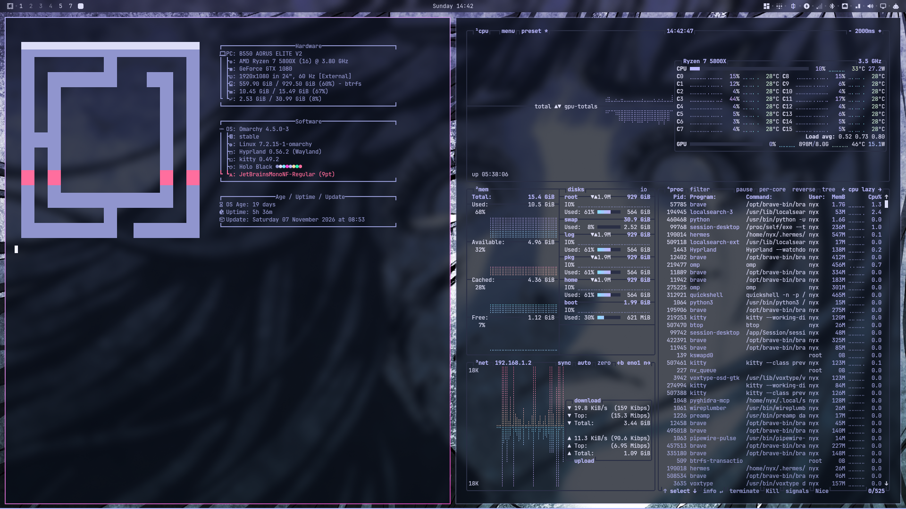
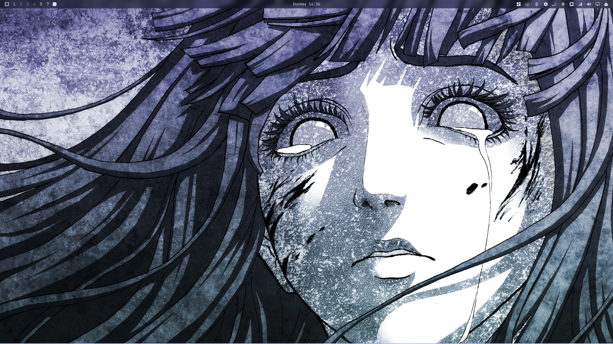

# Holo Black

An elegant, slightly mysterious Omarchy theme built around a glassy interface
floating in an unlit room. Indigo black and slate make the room; lavender is the
edge of every pane; magenta is the glint of something changing; mint appears
only when something succeeds.





`preview.png` is a real screenshot of this desktop (1920×1080) after applying
the theme, not a mock-up.

---

## Apply

```bash
omarchy theme install https://github.com/Binz120/holo-black
omarchy theme set "Holo Black"
```

The palette, `shell.toml`, `btop.theme`, `icons.theme`, the wallpapers, the
Plymouth wordmark and the lavender→magenta border all apply. Omarchy renders
the terminals, the editors and the other apps from `colors.toml`, so they
follow the same palette.

Switch between the four backgrounds with:

```bash
omarchy theme bg next
```

Your own wallpapers for this theme go in
`~/.config/omarchy/backgrounds/holo-black/`.

---

## Palette

Five anchors, everything else mixed from them:

| Colour     | Hex       | Role                                                        |
|------------|-----------|-------------------------------------------------------------|
| Ink        | `#0A0F1E` | The room: background, depth, scrim, shadow                  |
| Slate      | `#2A2F45` | Texture: selection, dividers, muted edges, inactive chrome  |
| Lavender   | `#B8B8FF` | Structure: panels, borders, focus, the lit edge of glass    |
| Magenta    | `#FF4FD8` | Attention: changes, alerts, countdowns, modified files      |
| Mint       | `#2EF9B6` | Success only: confirmation, completion, a clean exit        |

The full `colors.toml` adds the in-between values the templates need (a
lavender-tinted panel, an ice blue for cyan, a champagne for constants, a rose
for errors) and keeps them inside the same hue family.

**The mint rule.** There is no mint in `shell.toml`, none in `btop.theme`, and
none in the wallpapers. It appears in the terminal palette because `green` must
mean success there, and in the preview's two success marks. That restraint is
what makes magenta read as an event rather than decoration.

---

## The glass

- Windows: a 2px lavender→magenta hologram border on the focused window and a
  faint lavender edge on the rest.
- The bar is 82% opaque; menus, launchers, notifications and the lock field are
  between 92% and 96%, so the wallpaper is always slightly present.
- Shell borders use the same `hyprland.active-border` gradient as the
  compositor, so a notification, the lock field and the window it sits over
  agree.

---

## File map

| Path | Purpose |
|---|---|
| `colors.toml` | The palette. Feeds terminals, editors, btop, the shell and the templates. |
| `shell.toml` | Bar, menus, launcher, notifications, polkit, lock, image picker. |
| `btop.theme` | Slate boxes, lavender throughput, magenta load; no mint. |
| `icons.theme` | `Yaru-purple-dark`. |
| `backgrounds/` | Four 2560×1440 wallpapers, WebP (about 150 KB each). The signal rings are the default; lattice, noir ring and lavender veil follow. |
| `unlock.png` | The Omarchy wordmark in lavender, for Plymouth. |
| `preview.png`, `preview-terminal.png`, `preview-wallpaper.png`, `preview-unlock.png` | A browser-and-editor session, a terminal session, the bare desktop, and the lock screen. |

No stock files are touched: everything lives in
`~/.config/omarchy/themes/holo-black/`.

---

## License

MIT — see [`LICENSE`](LICENSE). The Omarchy wordmark in `unlock.png` is the
Omarchy project's; this theme only recolours it.
